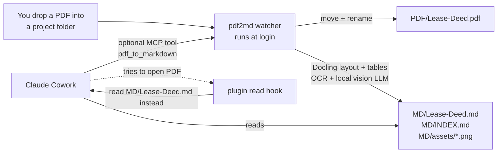

# PDF-OCR-MD-local-Converter (`pdf2md`)

Convert the PDFs you give Claude **once, on your own computer**, into clean Markdown that Claude Cowork
reads instead of the PDF. That includes OCR for scanned pages, real tables, and charts turned into text plus data. It saves tokens
on every later read and keeps your documents private.

- **High-quality OCR, fully local.** Scanned pages are transcribed by a local vision LLM (Qwen3-VL via
  [Ollama](https://ollama.com)) and **cross-checked** against classical OCR (Apple Vision on macOS,
  RapidOCR / Tesseract elsewhere). If the two disagree, the safer classical result is kept and the page is flagged.
- **Tables stay tables.** [Docling](https://github.com/docling-project/docling)'s TableFormer rebuilds table
  structure, which is then written as Markdown tables.
- **Charts and figures become readable.** Every chart or diagram is classified, saved as a PNG, and described by
  the local vision model with a **data table of its values**. Signatures, stamps and logos get short markers.
- **Organised automatically.** PDFs dropped into a project folder are moved to `PDF/` with a clean name.
  The Markdown goes to `MD/`, alongside an `INDEX.md` that Claude reads first.
- **Claude uses it automatically.** A background watcher converts new PDFs within seconds. A Claude plugin
  (skill + read hook), an MCP tool and a `CLAUDE.md` note steer Claude to the Markdown instead of the PDF.
- **Converted once.** Results are cached by file hash, so a PDF is only re-processed when it changes.

Nothing is uploaded anywhere. The internet is used only once, to download the OCR/layout models and the vision model.

---

## How it fits together



Claude Cowork runs in a sandbox on your computer and sees the folders you share with it. pdf2md runs
outside that sandbox, where it can use your GPU / Apple Silicon and the local LLM. The two meet in your
project folder: pdf2md writes the Markdown there, and Claude reads it.

Several layers steer Claude to the Markdown. Any one of them is enough, and together they are robust:

| Layer | What it does | Where |
|---|---|---|
| Background watcher | Converts every new/changed PDF in your project folders automatically | your computer (autostart) |
| `CLAUDE.md` block + `INDEX.md` | Each project tells Claude "read `MD/…`, not the PDF" | written into every project folder |
| Cowork plugin `pdf-markdown-first` | Skill with the workflow + a hook that redirects a PDF read to its `.md` | Claude Desktop > Customize > Plugins |
| Global instructions | The same rule for every chat and Cowork task | Settings > General > Instructions for Claude |
| MCP server (optional) | `pdf_to_markdown`, `read_markdown`, `list_converted` tools | Claude Desktop / Claude Code |

---

## Install

You need about 10 GB of free disk space: roughly 2 GB for Python packages and OCR/layout models, and 2-6 GB for the
vision model. Apple Silicon Macs and PCs with an NVIDIA GPU are fastest, but the tool also works on CPU only.

```bash
git clone https://github.com/sayakchandra-Lawyer/PDF-OCR-MD-local-Converter.git
cd PDF-OCR-MD-local-Converter
```

**macOS**

```bash
./scripts/install_mac.sh
```

**Windows** (PowerShell)

```powershell
powershell -ExecutionPolicy Bypass -File scripts\install_windows.ps1
```

**Linux** (for Claude Code): `./scripts/install_linux.sh`

Each installer:

1. installs [uv](https://docs.astral.sh/uv/) plus a private Python 3.12 in `~/.pdf2md/venv` (no admin rights needed);
2. installs pdf2md (Docling, RapidOCR, Apple Vision OCR on macOS, watchdog, MCP SDK);
3. installs **Ollama** (Homebrew or winget, or opens the download page);
4. runs `pdf2md setup`, which:
   - asks which folder holds your project folders (it suggests a Google Drive `Claude Projects/01_Active`
     folder if it finds one);
   - asks for OCR languages, e.g. `en,hi,bn`;
   - picks a vision model that fits your RAM (`qwen3-vl:8b-instruct` with 16 GB RAM or more, `4b` with 12-15 GB,
     `2b` below that) and downloads it;
   - installs the autostart entry for the watcher;
   - adds the MCP server to Claude Desktop (and to Claude Code if it is installed);
   - writes the Cowork plugin zip to your Desktop and prints the global-instructions text.

Then check everything with:

```bash
pdf2md doctor
```

### Finish the Claude side (2 minutes, once)

1. **Plugin.** In Claude Desktop open **Customize > Plugins > Upload** and pick
   `pdf-markdown-first-0.1.0.zip` from your Desktop. If you prefer, **Add marketplace** with
   `sayakchandra-Lawyer/PDF-OCR-MD-local-Converter` and install *pdf-markdown-first* from it.
   For a skill without the hook, upload `pdf-markdown-first-skill.zip` under **Settings > Capabilities > Skills**.
2. **Global instructions.** Paste the text printed by `pdf2md claude instructions` into
   **Settings > General > Instructions for Claude**.
3. **Restart Claude Desktop** so it loads the MCP server.
4. In Cowork, select your **project folder** (or the folder of project folders) as the working folder.

---

## Daily use

1. Save or drag PDFs into a project folder (not as chat attachments).
2. The watcher moves each one to `PDF/` and writes `MD/<name>.md` within seconds for digital PDFs, or a few
   minutes for long scans.
3. Ask Claude about the document as usual. It reads `MD/INDEX.md` and the Markdown, not the PDF.

A PDF attached directly to a chat is already in Claude's context, so the tool cannot save tokens for it.
Put PDFs you will reuse into the project folder instead.

### Folder layout

```
Claude Projects/01_Active/
└── P19_NTT-Colocation-MSA/
    ├── .pdf2md.json                 ← marker: tells Claude/the hook where things are
    ├── CLAUDE.md                    ← "read MD/, not the PDFs" (managed block, your text is kept)
    └── 01_Context/                  ← used automatically when the project has this folder
        ├── PDF/
        │   ├── NTT-MSA-Draft-v3.pdf     ← was "NTT MSA (Draft) v3.pdf"
        │   └── Order-sheet-scan.pdf
        └── MD/
            ├── INDEX.md                 ← table of all conversions + status
            ├── NTT-MSA-Draft-v3.md
            ├── Order-sheet-scan.md
            └── assets/NTT-MSA-Draft-v3/p007-fig01.png
```

- Projects without `01_Context/` get `PDF/` and `MD/` directly at the project root.
- Only PDFs dropped **at the top level** of the project (or of `01_Context/`) are moved. PDFs in other
  sub-folders, such as `03_Outputs/`, stay where they are; their Markdown mirrors the sub-folder under `MD/`.
- File names: spaces and awkward characters become `-`, and non-Latin scripts are kept. For a date prefix, set
  `name_template = "{date}_{stem}"`.
- Identical duplicates are not converted twice. A changed PDF is re-converted. `04_Archive/` and hidden folders are ignored.

### What the Markdown looks like

```markdown
---
title: "Annual Operations Report FY2025"
source_pdf: "PDF/Annual-Report-FY25.pdf"
original_filename: "Annual Report (FY25).pdf"
pages: 2
ocr_pages: []
tables: 1
figures: 1
vision_model: "qwen3-vl:8b-instruct"
warnings: []
---

# Annual Operations Report FY2025

> Local Markdown conversion of `PDF/Annual-Report-FY25.pdf` (2 pages). Read this instead of the PDF. ...

<!-- page 1 -->

## 2. Quarterly figures

| Quarter | Revenue (INR cr) | Costs (INR cr) | Margin % |
| - | - | - | - |
| Q1 | 120 | 80 | 33.3 |
...

<!-- page 2 -->

**[Figure 1 | page 2 | bar chart] Revenue vs Costs FY2025**

Figure 1: Revenue vs Costs by quarter.


Grouped bar chart of revenue and costs (INR crore) for Q1-Q4. Revenue rises from 120 to 172; costs from 80 to 99.

| Quarter | Revenue (INR cr) | Costs (INR cr) |
|---|---|---|
| Q1 | 120 | 80 |
...

_(Described by local vision model `qwen3-vl:8b-instruct`; verify critical values against the image.)_
```

`<!-- page N -->` markers let Claude cite pages and read only the pages it needs.

---

## OCR and accuracy

Each page is first checked with pdfium:

| Page type | Treatment |
|---|---|
| Digital (real text layer) | Text taken as-is. No OCR, so no OCR errors. Docling rebuilds layout, reading order and tables |
| Scanned (image only) | Full-page OCR with the classical engine **and** transcription by the local vision LLM; the vision result is used when it agrees with the classical OCR (≥ 55 % word overlap), otherwise the classical OCR is used and a warning is recorded |
| Scanned with an embedded text layer | Treated as scanned: the embedded layer is often poor, so the page is re-OCR'd (`redo_existing_text_layer`) |

The classical engine is picked automatically: Apple Vision (`ocrmac`) on macOS, Tesseract when several
languages are configured and it is installed, otherwise RapidOCR (PP-OCR). Set `[ocr] engine` to force one.

**Indian languages.** Set `languages = ["en", "hi"]` (or `bn`, `ta`, …). The vision model handles mixed-script pages.
For the classical engine, Tesseract with language packs is the best choice for Indic scripts:
`brew install tesseract tesseract-lang` / `winget install UB-Mannheim.TesseractOCR`.

**Vision models.** Change `[llm] vision_model` (figures) and `ocr_model` (scanned pages; empty = same model).
Recommended: `qwen3-vl:8b-instruct`, `qwen3-vl:4b-instruct` or `qwen3-vl:2b-instruct`. `glm-ocr` (0.9 B, very fast)
can be tried as `ocr_model` (experimental). Pull a new model with `pdf2md models pull`.

**Always verify.** Amounts, dates and case numbers from scans or chart readings should be checked against the
original. The Markdown says which pages were OCR'd and links every figure image. Claude is told to verify
critical values by looking at that single page.

---

## Commands

| Command | What it does |
|---|---|
| `pdf2md setup` | First-time wizard (folders, languages, models, autostart, Claude wiring) |
| `pdf2md convert <pdf or folder> [--force] [--no-move] [--no-figures]` | Convert now |
| `pdf2md scan` | Convert everything new in the watched folders once |
| `pdf2md status [project]` | Watcher state and every converted document |
| `pdf2md add-folder <folder> [--single]` | Watch a folder of projects (or one project) |
| `pdf2md autostart install / uninstall / restart / status` | Background watcher at login |
| `pdf2md models pull / list` | Download / list the Ollama vision models |
| `pdf2md claude install-mcp / plugin-zip / instructions` | Claude Desktop MCP entry, Cowork plugin zip, instructions text |
| `pdf2md doctor` | Check the whole installation |
| `pdf2md watch` | Run the watcher in the foreground (for debugging) |
| `pdf2md mcp [--http]` | MCP server (started by Claude; `--http` serves on 127.0.0.1:8765) |

The configuration lives in `~/.pdf2md/config.toml` (see [`config.example.toml`](config.example.toml)) and
the logs in `~/.pdf2md/logs/`. Run `pdf2md autostart restart` after editing.

### MCP tools

| Tool | Purpose |
|---|---|
| `pdf_to_markdown(pdf_path, include_content=True, force=False)` | Convert (or return the cached conversion). Paths seen inside Cowork (`/sessions/…/mnt/<folder>/…`) are mapped to your disk |
| `read_markdown(document, pages="3-5")` | Read selected pages of a converted document |
| `list_converted(query, project)` | Search across all projects |
| `convert_folder(folder)` | Queue a whole folder |
| `converter_status()` | Ollama, models, OCR engine, watcher |

---

## Claude Cowork notes

- Anthropic documents local `claude_desktop_config.json` MCP servers as unavailable in Cowork. Some users
  report Claude Desktop bridging them into Cowork anyway. pdf2md therefore **does not depend on MCP in Cowork**:
  the watcher, `INDEX.md`/`CLAUDE.md`, the plugin and global instructions cover Cowork. The MCP tools are a bonus
  wherever they are available (Claude Desktop chat, Claude Code, and Cowork if the bridge works).
- The plugin's read hook is plain Python with no dependencies, so it runs inside Cowork's sandbox. When Claude tries
  to `Read` a converted PDF, the hook blocks the read and points Claude at the `.md`. If a conversion is still
  running, the hook waits up to 150 s. Reading specific `pages` of the PDF is always allowed, for deliberate
  visual checks.
- Plugins are new in Cowork. If the hook or skill does not fire in your version, the `CLAUDE.md` block,
  `INDEX.md` and global instructions still direct Claude to the Markdown.

## Privacy

All conversion runs on your computer: Docling, OCR and Ollama listen only on `127.0.0.1`. pdf2md sends no telemetry.
Network access happens only when models are first downloaded (Hugging Face for Docling/RapidOCR models,
ollama.com for the vision model). If your project folders sync to Google Drive, the generated Markdown syncs
too. Treat it with the same confidentiality as the source PDFs.

## Troubleshooting

| Symptom | Fix |
|---|---|
| Nothing gets converted on macOS | Grant **Full Disk Access** to the Python binary that `install_mac.sh` prints at the end, then `pdf2md autostart restart` |
| `pdf2md doctor`: Ollama not reachable | Start the Ollama app (menu-bar icon), then `pdf2md models pull` |
| Figures say "no text description" | The vision model was missing during conversion: `pdf2md models pull`, then `pdf2md convert --force <pdf>` |
| Slow conversions on CPU-only PCs | Use a smaller model (`vision_model = "qwen3-vl:2b-instruct"`), `[tables] mode = "fast"`, or `--no-figures` |
| Network drive / cloud folder events missed | `[watch] use_polling = true` (a full rescan also runs every 10 minutes) |
| Claude Desktop MCP not visible (Windows Store version) | `pdf2md claude install-mcp` also writes the MSIX config path; restart Claude Desktop fully from the tray |
| A conversion failed | The error is in `INDEX.md` and `~/.pdf2md/logs/watcher.log`; retry with `pdf2md convert --force <pdf>` |

## Development

```bash
uv venv --python 3.12 && uv pip install -e ".[dev]"
python tests/fixtures/make_fixtures.py          # sample digital + scanned PDFs
pytest -m "not slow"                            # fast unit tests
pytest                                          # + end-to-end Docling runs with a fake Ollama server
```

Layout: `src/pdf2md/` (converter, service, watcher, MCP server, CLI), `claude-plugin/` (Cowork/Claude Code
plugin), `.claude-plugin/marketplace.json` (lets this repo act as a plugin marketplace), `scripts/` (installers).

## License

MIT. The bundled and downloaded components are also permissively licensed: Docling (MIT), RapidOCR (Apache-2.0), ocrmac (MIT),
Ollama (MIT) and Qwen3-VL (Apache-2.0).
